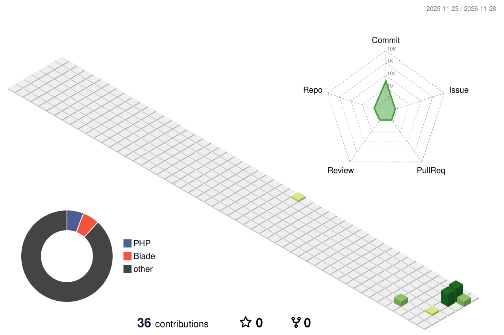

 

---

## 👩‍💻 Tentang Saya

- 👋 Halo! Saya **Riska Ayu Nauli**, penggemar dunia coding dan teknologi.
- 📍 Tinggal di **Medan, Indonesia** 🇮🇩
- 💻 Skill yang sedang saya kembangkan: **VS Code, Java, Python, SQL**, dan lainnya
- 🌱 Yang sedang saya pelajari saat ini: **Database**
- 📫 Hubungi saya lewat **naulimaba@gmail.com**
- ⚡ Fun fact: suka mencoba hal baru, terutama kalau berhubungan dengan kode!

---

## 🛠️ Tech Stack & Tools

  
  
  
  
  
  

---

## 🌱 Sedang Dipelajari

| Topik | Status |
| :-- | :-- |
| 🗄️ Database (fokus utama saat ini) | 📖 Sedang dipelajari |
| 🧾 SQL | 🔄 Terus diasah |
| ☕ Java | 🔄 Terus diasah |
| 🐍 Python | 🔄 Terus diasah |

---

## 📊 Statistik GitHub

---

## 📈 Aktivitas Kontribusi

---

## 📣 Mari Terhubung

  
  
  

  
Statistik waktu coding (WakaTime)
 

<!--START_SECTION:waka-->
<!--END_SECTION:waka-->

---

*"Belajar sedikit demi sedikit, lama-lama jadi bukit."* ✨

